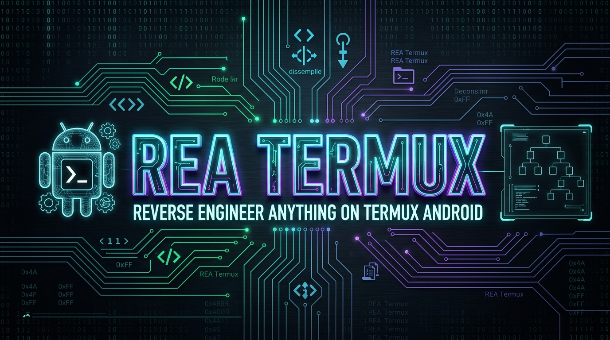
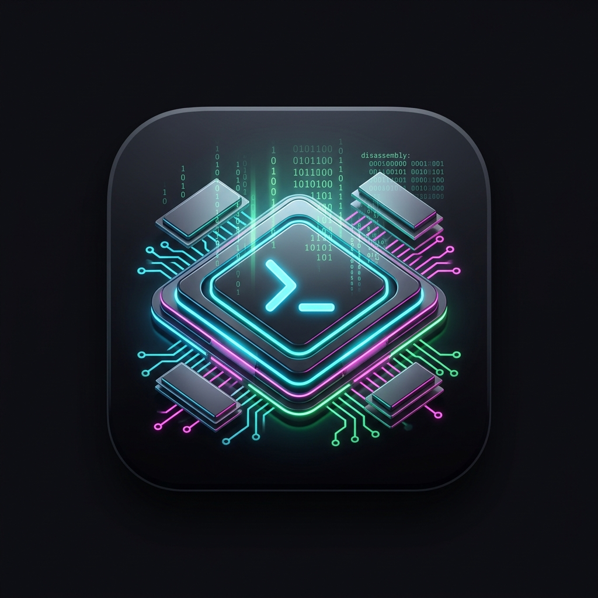

<div align="center">



<br/><br/>



# REA for Termux Android 🤖⚡

### Reverse Engineer Anything — Adaptación, Guía y Configuración para Termux / Android

[](https://termux.dev/)
[](https://nodejs.org/)
[](LICENSE)
[](https://modelcontextprotocol.io/)

[Características](#-características) • [Instalación Rápida](#-instalación-rápida) • [Compilación en Termux](#-compilación-en-termux) • [Uso y Comandos](#-uso-y-comandos) • [Integración MCP](#-integración-mcp)

</div>

---

## 📌 ¿Qué es REA?

**REA (Reverse Engineer Anything)** es una plataforma unificada para ingeniería inversa y análisis de software en binarios nativos, aplicaciones JavaScript/Electron, ejecutables .NET, firmas APK y ecosistemas Web.

Este repositorio proporciona la configuración, scripts de automatización e instrucciones específicas para compilar y ejecutar **REA directamente en Android mediante Termux** (ARM64).

---

## 🚀 Características

- 🔍 **Inspección Multi-Plataforma**: Análisis estático de aplicaciones web, empaquetados JS/Electron y binarios.
- ⚡ **Compilación Optimizada para Termux**: Adaptado para manejar los límites de memoria y arquitecturas ARM64 con compilador dedicado (`typescript-termux`).
- 🤖 **Servidor MCP**: Integración directa con asistentes IA (Gemini CLI, Antigravity, Claude Code, Cursor, Copilot CLI, etc.).
- 📦 **Scripts Todo-en-Uno**: Script interactivo `install-termux.sh` para clonar, instalar dependencias y compilar sin fricción.

---

## 🖼️ Interfaz & Análisis

<div align="center">
  
</div>

---

## 🛠️ Requisitos Previos en Termux

Asegúrate de contar con los paquetes base actualizados:

```bash
pkg update -y
pkg install -y nodejs-lts git python
```

---

## 💻 Instalación Rápida

Puedes clonar este repositorio y ejecutar el script automatizado:

```bash
git clone https://github.com/kuromi04/rea-termux.git
cd rea-termux
chmod +x install-termux.sh
./install-termux.sh
```

### ⚙️ Instalación y Compilación Manual

Si prefieres realizar los pasos manualmente:

1. **Clonar REA:**
   ```bash
   git clone https://github.com/morluto/rea.git
   cd rea
   ```

2. **Instalar dependencias permitiendo la versión de Node de Termux:**
   ```bash
   npm install --engine-strict=false
   ```

3. **Compilar el runtime para Termux (ARM64):**
   ```bash
   npm run build:termux
   ```

4. **Verificar estado:**
   ```bash
   node scripts/rea.mjs --help
   ```

---

## 🎯 Comandos Principales

Ejecuta el CLI de REA o el menú 3D desde la terminal:

| Comando | Descripción |
| :--- | :--- |
| `rea --help` / `rea --version` | Muestra la lista de comandos (optimizado con fast-path <35ms) |
| `rea-menu` / `aegisforge-menu` | Inicia la matriz galáctica Obsidian 3D interactiva en navegador (`http://localhost:8888`) |
| `rea doctor` | Verifica el estado de motores de análisis y dependencias |
| `rea analyze <target>` | Diagnóstico y resumen de una aplicación o binario |
| `rea capture-adb-screen` | Captura pantalla de dispositivo Android conectado con auto-detección ADB |
| `rea mcp` | Inicia REA en modo servidor stdio MCP para agentes IA |

---

## 🛡️ Ecosistema AegisForge

Para una suite de ingeniería inversa completa que además incluya **Radare2 (desensamblado nativo C/ASM)** y **JADX (decompilación de APKs a Java)** sobre el protocolo MCP, consulta el proyecto hermano:
👉 **[AegisForge (kuromi04/AegisForge)](https://github.com/kuromi04/AegisForge)**

---

## 🔌 Integración con MCP (Model Context Protocol)

Para enlazar REA con tus clientes MCP de Inteligencia Artificial en Termux, añade la siguiente configuración a tu cliente compatible (ej. `mcp_config.json` o settings de tu agente):

```json
{
  "mcpServers": {
    "rea": {
      "command": "node",
      "args": [
        "/data/data/com.termux/files/home/Projects/rea-termux/rea/scripts/rea.mjs",
        "mcp"
      ]
    }
  }
}
```

---

## 📜 Licencia y Créditos

- Basado en el proyecto original [REA (morluto/rea)](https://github.com/morluto/rea) bajo licencia MIT.
- Guías y optimización para Termux por [kuromi04](https://github.com/kuromi04).
